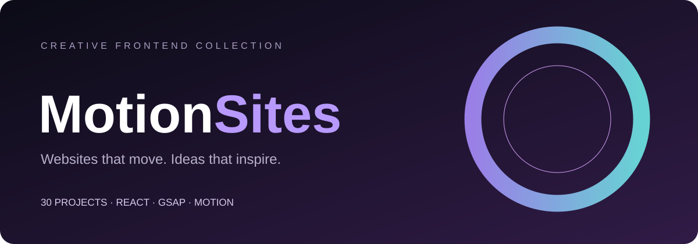

<p align="center">
  
</p>

<h1 align="center">MotionSites</h1>
<p align="center"><strong>30 motion-driven websites. One place to explore creative frontend ideas.</strong></p>
<p align="center">A curated collection of animated landing pages, experimental interfaces, and portfolio concepts built with modern web technologies.</p>

<p align="center">
  <a href="https://github.com/Jackxiaozhiren/MotionSites/stargazers"></a>
  
  <a href="https://github.com/Jackxiaozhiren/MotionSites/issues"></a>
</p>

<p align="center">
  <a href="https://jackxiaozhiren.github.io/MotionSites/"><strong>🌐 Live interactive gallery</strong></a> ·
  <a href="#explore-the-collection"><strong>Explore projects</strong></a> ·
  <a href="#quick-start"><strong>Run locally</strong></a> ·
  <a href="README.zh-CN.md"><strong>简体中文</strong></a> ·
  <a href="https://github.com/Jackxiaozhiren/MotionSites/stargazers"><strong>⭐ Star this repo</strong></a>
</p>

---

## 🌐 Explore the interactive gallery

A **searchable, filterable, motion-inspired gallery** is included in [`site/`](site/): browse all 30 projects by technology, find a concept quickly, and open each project's source on GitHub.

**[🌐 Explore the live gallery](https://jackxiaozhiren.github.io/MotionSites/)** · [Preview locally](docs/GALLERY_DEPLOY.md) · [How to publish](docs/GALLERY_DEPLOY.md#publish-to-github-pages)

> The gallery includes **real screenshots and live demo builds for selected verified projects** (Jack Portfolio, Prisma, Axion Studio, Wanderful and Foundation). All other projects have clearly labeled concept covers and source links; we do **not** claim all 30 are hosted.

### ✨ Real website previews

These are actual screenshots captured from running project builds, not generated concept art. Click a thumbnail to try the hosted preview. Some third-party assets may depend on external services.

<table>
<tr>
<td width="33%" valign="top">
<a href="https://jackxiaozhiren.github.io/MotionSites/demos/jack-portfolio/"></a><br>
<strong>Jack · 3D Creator</strong><br>
<a href="https://jackxiaozhiren.github.io/MotionSites/demos/jack-portfolio/">Live demo ↗</a> · <a href="https://github.com/Jackxiaozhiren/MotionSites/tree/main/1/jack-portfolio">Source ↗</a>
</td>
<td width="33%" valign="top">
<a href="https://jackxiaozhiren.github.io/MotionSites/demos/prisma-landing/"></a><br>
<strong>Prisma — Creative Studio</strong><br>
<a href="https://jackxiaozhiren.github.io/MotionSites/demos/prisma-landing/">Live demo ↗</a> · <a href="https://github.com/Jackxiaozhiren/MotionSites/tree/main/3/prisma-landing">Source ↗</a>
</td>
<td width="33%" valign="top">
<a href="https://jackxiaozhiren.github.io/MotionSites/demos/foundation/"></a><br>
<strong>Foundation — New Digital Epoch</strong><br>
<a href="https://jackxiaozhiren.github.io/MotionSites/demos/foundation/">Live demo ↗</a> · <a href="https://github.com/Jackxiaozhiren/MotionSites/tree/main/29">Source ↗</a>
</td>
</tr>
</table>


### 🧠 Go beyond the screenshot: implementation guides

Every catalog card now links to a [project guide](https://jackxiaozhiren.github.io/MotionSites/project.html?id=20) with the source directory, local start commands, honest preview availability, and a note about external assets. **Five featured guides are based on inspected source code**, not generated assumptions:

| Project | What to learn | Guide |
|---|---|---|
| Jack · 3D Creator | Fade-in timing, pointer magnets, scroll-driven marquee | [Open →](https://jackxiaozhiren.github.io/MotionSites/project.html?id=1) |
| Prisma | Animated typography and scroll-triggered features | [Open →](https://jackxiaozhiren.github.io/MotionSites/project.html?id=3) |
| Axion Studio | GSAP mouse parallax and video-frame boomerang | [Open →](https://jackxiaozhiren.github.io/MotionSites/project.html?id=20) |
| Wanderful | Layered video hero and parallax | [Open →](https://jackxiaozhiren.github.io/MotionSites/project.html?id=22) |
| Foundation | Motion entrance, floating navigation and marquee | [Open →](https://jackxiaozhiren.github.io/MotionSites/project.html?id=28) |

For implementation-note maintenance see [PROJECT_GUIDES.md](docs/PROJECT_GUIDES.md). Third-party images, videos and logos **are not automatically available for reuse**; read the [initial source/media audit](docs/ASSET_PROVENANCE_AUDIT.md) and [credits](CREDITS.md). This repository is a set of independent frontend concepts, not verified production software or a universally licensed asset pack.

## Why MotionSites?

Modern websites are more than static layouts. MotionSites collects **30 independent, browsable source projects** so designers and frontend developers can explore how different visual styles and interactions are put together.

- **Get inspired** — browse creative landing-page and portfolio concepts.
- **Learn from real code** — open each project's source instead of settling for a screenshot.
- **Try different motion approaches** — examples include GSAP, Framer Motion, Motion, and CSS-driven UI.
- **Experiment locally** — most projects have their own Vite setup; a few run as standalone HTML pages.

> **Note:** This is a collection of independent demo projects, **not** one installable component library or a single app. Some demos require external assets or services to look their best.

## ✨ Explore the collection

Start with a few different styles and animation stacks:

| Project | Focus | Explore |
|---|---|---|
| **Jack · 3D Creator** | Creative portfolio concept with Framer Motion | [View source →](https://github.com/Jackxiaozhiren/MotionSites/tree/main/1/jack-portfolio) |
| **Prisma — Creative Studio** | Creative studio landing page | [View source →](https://github.com/Jackxiaozhiren/MotionSites/tree/main/3/prisma-landing) |
| **Axion Studio** | GSAP-driven landing page | [View source →](https://github.com/Jackxiaozhiren/MotionSites/tree/main/21) |
| **Wanderful** | Travel-inspired website with GSAP | [View source →](https://github.com/Jackxiaozhiren/MotionSites/tree/main/22) |
| **Foundation — New Digital Epoch** | Motion-powered digital experience | [View source →](https://github.com/Jackxiaozhiren/MotionSites/tree/main/29) |
| **Hero Liquid Glass** | Liquid-glass hero exploration | [View source →](https://github.com/Jackxiaozhiren/MotionSites/tree/main/hero-liquid-glass) |

**Want to see the motion in action?** Clone a project and run it locally using the instructions below. Selected projects offer verified demo builds in the gallery; others remain source-only. See [the visual showcase guide](docs/SHOWCASE_GUIDE.md) for how to add genuine captures and live URLs later.

### Find projects by technology

- **GSAP:** [Axion Studio](https://github.com/Jackxiaozhiren/MotionSites/tree/main/21) · [Wanderful](https://github.com/Jackxiaozhiren/MotionSites/tree/main/22)
- **Motion:** [RIVR](https://github.com/Jackxiaozhiren/MotionSites/tree/main/19) · [Foundation](https://github.com/Jackxiaozhiren/MotionSites/tree/main/29) · [dot.](https://github.com/Jackxiaozhiren/MotionSites/tree/main/30)
- **Framer Motion:** [Jack · 3D Creator](https://github.com/Jackxiaozhiren/MotionSites/tree/main/1/jack-portfolio) · [Prisma](https://github.com/Jackxiaozhiren/MotionSites/tree/main/3/prisma-landing) · [Nexora](https://github.com/Jackxiaozhiren/MotionSites/tree/main/20) · [Mindloop](https://github.com/Jackxiaozhiren/MotionSites/tree/main/24/mindloop)
- **Standalone HTML:** [Venture](https://github.com/Jackxiaozhiren/MotionSites/tree/main/7) · [Duolingo — Style Guide](https://github.com/Jackxiaozhiren/MotionSites/tree/main/27)

<details>
<summary><strong>📚 View all 30 projects (click to expand)</strong></summary>

<br />

| # | Project | Stack / Technology | Source |
|:--:|---|---|:--:|
| 01 | **Jack · 3D Creator** | React · Framer Motion · Tailwind · Vite · TS | [Open ↗](https://github.com/Jackxiaozhiren/MotionSites/tree/main/1/jack-portfolio) |
| 02 | **Mainframe** | React · Tailwind · Vite · TS | [Open ↗](https://github.com/Jackxiaozhiren/MotionSites/tree/main/2) |
| 03 | **Prisma — Creative Studio** | React · Framer Motion · Tailwind · Vite · TS | [Open ↗](https://github.com/Jackxiaozhiren/MotionSites/tree/main/3/prisma-landing) |
| 04 | **Velorah** | React · Tailwind · Vite · TS | [Open ↗](https://github.com/Jackxiaozhiren/MotionSites/tree/main/4) |
| 05 | **Password Manager** | React · Framer Motion · Tailwind · Vite · TS | [Open ↗](https://github.com/Jackxiaozhiren/MotionSites/tree/main/5) |
| 06 | **Aethera** | React · Tailwind · Vite · TS | [Open ↗](https://github.com/Jackxiaozhiren/MotionSites/tree/main/6) |
| 07 | **Venture — Space Travel** | Standalone HTML · CDN | [Open ↗](https://github.com/Jackxiaozhiren/MotionSites/tree/main/7) |
| 08 | **VEX** | React · Tailwind · Vite · TS | [Open ↗](https://github.com/Jackxiaozhiren/MotionSites/tree/main/8) |
| 09 | **Forma** | React · Tailwind · Vite · TS | [Open ↗](https://github.com/Jackxiaozhiren/MotionSites/tree/main/10) |
| 10 | **Asme** | React · Tailwind · Vite · TS | [Open ↗](https://github.com/Jackxiaozhiren/MotionSites/tree/main/11) |
| 11 | **Orbis.Nft** | React · Tailwind · Vite · TS | [Open ↗](https://github.com/Jackxiaozhiren/MotionSites/tree/main/12) |
| 12 | **VaultShield** | React · Framer Motion · Tailwind · TS | [Open ↗](https://github.com/Jackxiaozhiren/MotionSites/tree/main/13) |
| 13 | **Asme (Motion)** | React · Framer Motion · Tailwind · Vite · TS | [Open ↗](https://github.com/Jackxiaozhiren/MotionSites/tree/main/14) |
| 14 | **securify** | React · Tailwind · Vite · TS | [Open ↗](https://github.com/Jackxiaozhiren/MotionSites/tree/main/15) |
| 15 | **CINEMATIC** | React · Tailwind · Vite | [Open ↗](https://github.com/Jackxiaozhiren/MotionSites/tree/main/16) |
| 16 | **LinkFlow** | React · Tailwind · Vite · TS | [Open ↗](https://github.com/Jackxiaozhiren/MotionSites/tree/main/17) |
| 17 | **Motion Sites 18** | React · Tailwind · Vite · TS | [Open ↗](https://github.com/Jackxiaozhiren/MotionSites/tree/main/18) |
| 18 | **RIVR** | React · Motion · Tailwind · Vite · TS | [Open ↗](https://github.com/Jackxiaozhiren/MotionSites/tree/main/19) |
| 19 | **Nexora** | React · Framer Motion · Tailwind · Vite · TS | [Open ↗](https://github.com/Jackxiaozhiren/MotionSites/tree/main/20) |
| 20 | **Axion Studio** | React · GSAP · Tailwind · Vite · TS | [Open ↗](https://github.com/Jackxiaozhiren/MotionSites/tree/main/21) |
| 21 | **Axion Studio (subproject)** | React · Tailwind · Vite · TS | [Open ↗](https://github.com/Jackxiaozhiren/MotionSites/tree/main/21/9) |
| 22 | **Wanderful** | React · GSAP · Tailwind · Vite · TS | [Open ↗](https://github.com/Jackxiaozhiren/MotionSites/tree/main/22) |
| 23 | **Mindloop** | React · Framer Motion · Tailwind · Vite · TS | [Open ↗](https://github.com/Jackxiaozhiren/MotionSites/tree/main/24/mindloop) |
| 24 | **Equilibrium** | React · Tailwind · Vite · TS | [Open ↗](https://github.com/Jackxiaozhiren/MotionSites/tree/main/25) |
| 25 | **Xero** | React · Vite · TS | [Open ↗](https://github.com/Jackxiaozhiren/MotionSites/tree/main/26) |
| 26 | **Duolingo — Style Guide** | Standalone HTML | [Open ↗](https://github.com/Jackxiaozhiren/MotionSites/tree/main/27) |
| 27 | **Newsletter Design** | React · Tailwind · Vite · TS | [Open ↗](https://github.com/Jackxiaozhiren/MotionSites/tree/main/28/newsletter-design) |
| 28 | **Foundation — New Digital Epoch** | React · Motion · Tailwind · Vite · TS | [Open ↗](https://github.com/Jackxiaozhiren/MotionSites/tree/main/29) |
| 29 | **dot.** | React · Motion · Tailwind · Vite · TS | [Open ↗](https://github.com/Jackxiaozhiren/MotionSites/tree/main/30) |
| 30 | **Hero Liquid Glass** | React · Vite · TS | [Open ↗](https://github.com/Jackxiaozhiren/MotionSites/tree/main/hero-liquid-glass) |

</details>


### Discover and share a gallery view

The [live gallery](https://jackxiaozhiren.github.io/MotionSites/) can filter by animation stack, search by title or source path, and show only projects with verified live demos. Press `/` to focus search, or `Escape` to clear it. Select **Share this view** to copy a URL that retains the current search, stack and live-demo filters. These are browser-side filters and do not track visitors.

**Preview availability:** screenshots and hosted demos only appear after the GitHub Actions capture pipeline successfully builds and verifies them. Projects without verified demos remain available through their source links. The gallery's single project index is [`site/projects.json`](site/projects.json); [`site/app.js`](site/app.js) loads it directly rather than duplicating the list.

**Validate the gallery before a PR:** `python3 scripts/check_gallery.py`. This checks project paths, catalog consistency, key accessibility controls and README source links; it does not replace a browser-level visual or performance audit.


**Share previews:** An original editable [MotionSites social-card SVG](assets/motionsites-social-card.svg) is rendered to a lightweight 1280×640 JPG in GitHub Actions. The deployed gallery uses this image in Open Graph metadata; GitHub's repository-level **Social preview** still requires a manual settings upload using the CI artifact. The card contains no copied website screenshots or external logos. See [owner launch setup](GITHUB_SETUP.md).

### Reliability, accessibility and source attribution

The featured GSAP/Motion demos are progressively being hardened for reduced-motion preferences and unreliable remote media. Gallery and detail pages show truthful fallback artwork when a published screenshot cannot load, rather than an empty broken-image area. New GitHub Actions browser checks test filtering, keyboard use, project guides, mobile layout and reduced motion; affected demos also undergo independent TypeScript/Vite builds.

**External resources require separate verification:** some projects load video, GIF, font or image assets from third-party services, including [motionsites.ai](https://motionsites.ai/). Their presence in the source does not establish redistribution rights or any affiliation with the referenced service. See [asset provenance audit](docs/ASSET_PROVENANCE_AUDIT.md) and the [automated URL-inventory workflow](.github/workflows/asset-inventory.yml). The repository does **not** currently provide a blanket license for third-party artwork or source.


**Measured quality baseline:** [Accessibility and Lighthouse Baseline](docs/QUALITY_AUDIT.md) runs axe-core WCAG A/AA scans for desktop/mobile gallery and project guides, plus synthetic Lighthouse scores in GitHub Actions. View the CI artifact for real test results; scores depend on browser/settings and should not be presented as real-user metrics. Human keyboard, mobile and asset-rights review are still required.

## 🚀 Quick start

Each subproject is self-contained. For most React / Vite projects:

```bash
git clone https://github.com/Jackxiaozhiren/MotionSites.git
cd MotionSites/21
npm install
npm run dev
```

Open the local URL printed by Vite (usually `http://localhost:5173`). To try a different project, enter its folder and repeat the install/run steps.

For **standalone HTML** projects ([`7`](https://github.com/Jackxiaozhiren/MotionSites/tree/main/7) and [`27`](https://github.com/Jackxiaozhiren/MotionSites/tree/main/27)), open the project's `index.html` in a browser. External CDN resources may need an internet connection.

**Builds:** Many Vite-based subprojects also expose `npm run build`. Run commands **inside the individual project directory**; there is no root-level app install command.

## 🗂 Repository structure

```text
MotionSites/
├── 1/ ... 30/               # Individual website experiments (some nested)
├── hero-liquid-glass/      # Separate hero experiment
├── assets/                 # README branding and future captures
├── site/                   # Static gallery for GitHub Pages
├── scripts/                # Gallery validation
├── docs/                   # Showcase + deployment guidance
├── .github/                # Issue & PR templates
├── README.md
├── README.zh-CN.md
└── CONTRIBUTING.md
```

## 🤝 Contributing & feedback

Found a bug, noticed a broken asset, or have an idea for the collection?

- [Open an issue](https://github.com/Jackxiaozhiren/MotionSites/issues/new/choose) with the project path and steps to reproduce.
- Read [CONTRIBUTING.md](CONTRIBUTING.md) before sending a pull request.
- For design inspiration, source code, fonts, images, and trademarks, please respect original creators and applicable licenses. See [CREDITS.md](CREDITS.md).

## 📍 What's next?

In this update, a searchable **source-code gallery** is included under [`site/`](site/). Upcoming improvements: screenshots and short clips for more projects, additional live previews, and more complete source/asset credits.

## ❤️ Support

If you find a useful interaction or a new design direction here, consider **[starring MotionSites](https://github.com/Jackxiaozhiren/MotionSites/stargazers)**. It helps more frontend developers discover the collection.

**Made & curated by [Jackxiaozhiren](https://github.com/Jackxiaozhiren).**